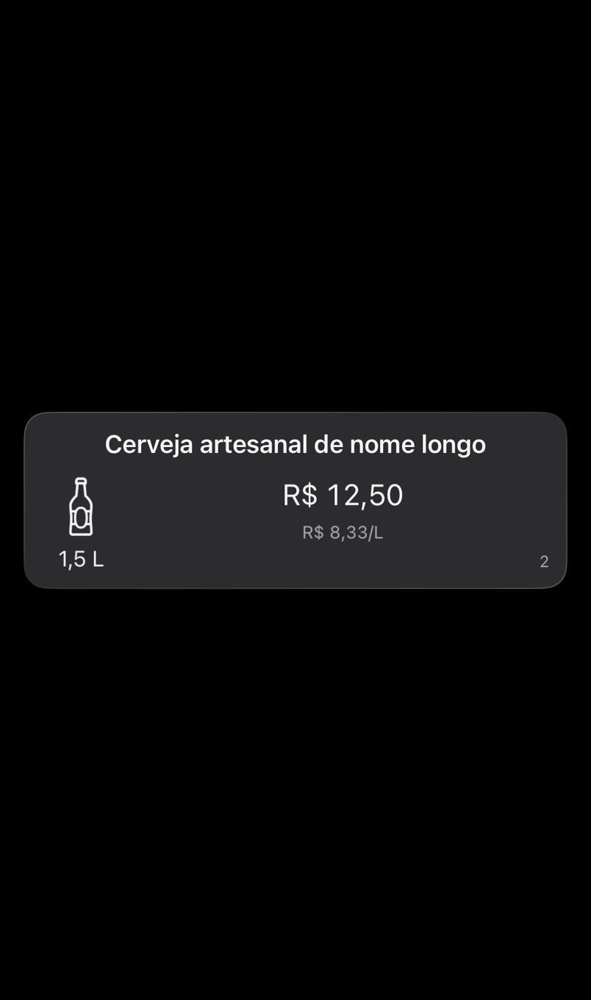
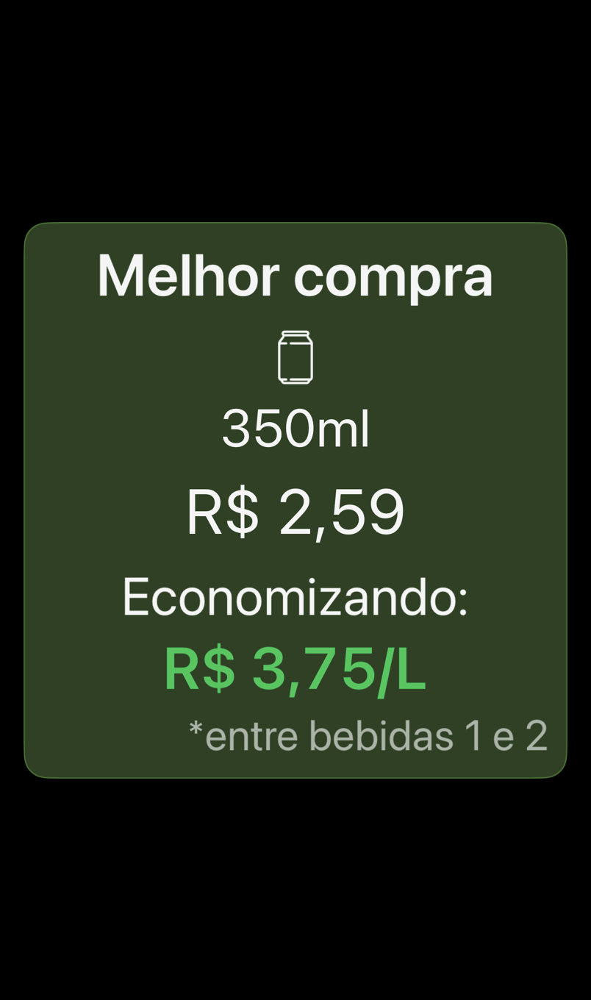

# Presentation snapshots

`BeerPresentationSnapshotTests` uses the existing SnapshotTesting package's
`.lines` strategy. Five committed UTF-8 baselines protect visible volume labels,
currency and cents input, editor presets and custom volume previews, ranked card
updates, and highlighted card presentation. Snapshot payloads omit managed object
IDs and use explicit fixture values. Card tests use the real worker with a
repository spy, so changes to volume exercise rate calculation and formatting
without persistence or network calls.

These are text presentation snapshots, not rendered UI images. They do not
detect layout, clipping, typography, accessibility, or color regressions.
`BeerMaisVisualTests/BeerVisualSnapshotTests` additionally renders the real `BeerView` inside a
`UIHostingController`. Eight PNG references cover ranked/highlighted cards in
light/dark appearance at standard and accessibility text sizes. Resources use
the existing `Bundle.beerMais`, so icons, colors and translations are included
in both test targets. The visual target is hosted in the real app so hierarchy
rendering preserves material effects and dynamic colors. Test startup shows a
blank window and skips services, notifications, analytics and persistent data;
card fixtures use an in-memory repository.

Run on macOS with Xcode and an available simulator:

```sh
xcodebuild test -project BeerMais.xcodeproj -scheme BeerMais \
  -destination 'platform=iOS Simulator,id=<SIMULATOR-UDID>' \
  -only-testing:BeerMaisTests/BeerPresentationSnapshotTests
```

Use `xcodebuild -list -project BeerMais.xcodeproj` and
`xcrun simctl list devices available` to choose the local scheme and device.
Baselines live beside the test source in
`__Snapshots__/BeerPresentationSnapshotTests`; they do not need target resource
membership. Only the Swift source requires test target membership.

For an intentional presentation change, change the affected assertion's
`record: false` to `record: true`, run that test on macOS, review the exact text
diff, then restore `record: false` and rerun. Keep automatic recording disabled
in CI. Do not accept newly generated references without reviewing their output.

## Visual references

The reference environment is Xcode 26.3, iOS 26.2, iPhone 17 Pro, Portuguese
(Brazil), a 402×680-point canvas, and 2× image scale. Visual tests explicitly
skip other iOS runtimes; behavioral/text tests still run. CI selects iOS 26.2
and compares references with recording disabled. Every pixel is compared with
98% perceptual precision to tolerate small antialiasing differences.

PNG files live in `BeerMaisVisualTests/__Snapshots__/BeerVisualSnapshotTests`. GitHub Actions
publishes a `visual-snapshots` artifact for viewing/downloading them; failures
also attach reference/actual/difference images to the `.xcresult` bundle.

For an intentional visual change on the reference runtime:

```sh
TEST_RUNNER_BEERMAIS_RECORD_SNAPSHOTS=1 ./scripts/run-tests.sh
```

Recording deliberately fails the assertions. Review every changed PNG, unset
the variable, and rerun comparison mode before committing. Missing references
fail without automatically creating or accepting baselines in comparison mode.
Editor screens, alerts, and full-screen navigation are not covered by these
initial card snapshots.

## Preview

Normal card in dark appearance:



Highlighted card with accessibility text:


